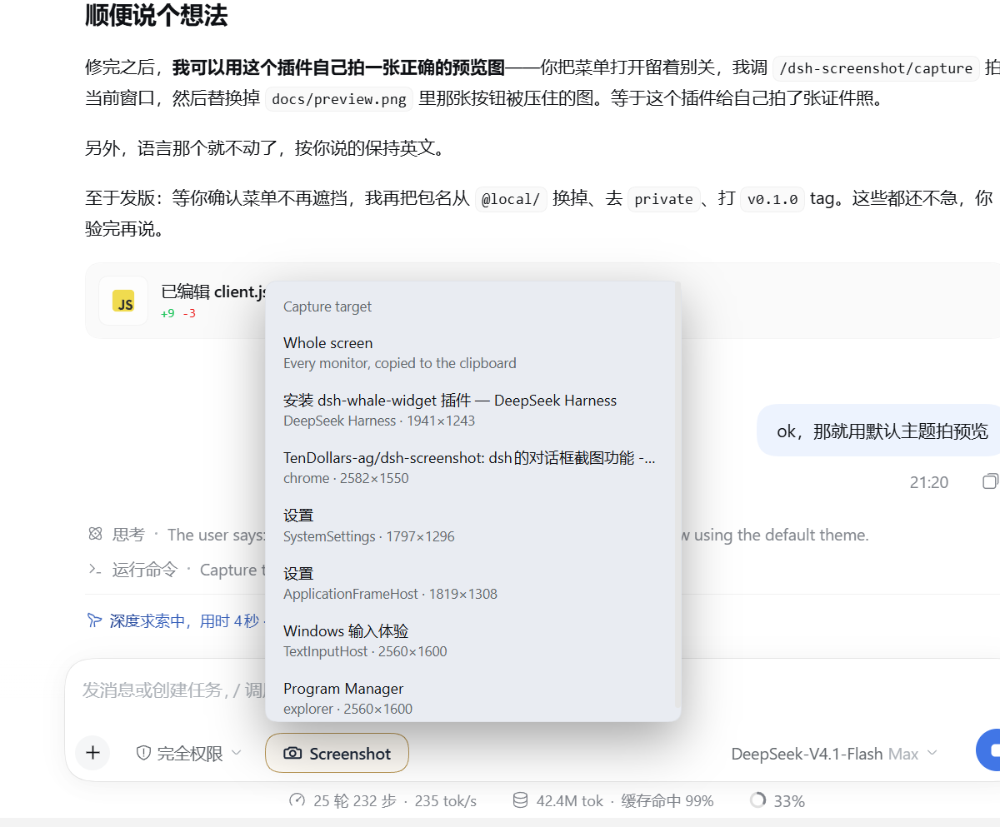

# dsh-screenshot

A screenshot button for the [DeepSeek Harness](https://github.com/deepseek-ai/deepseek-harness) composer: capture the whole screen or one chosen window, save it as a PNG, and copy it to the clipboard so it can be pasted into the message box.

输入框旁的截图按钮：截取整个屏幕或指定窗口，存成 PNG 并复制到剪贴板，按 `Ctrl+V` 直接粘贴成附件。



## Features

- **Target picker** — one menu lists the whole screen plus every open window (title, process, size).
- **Window capture via `PrintWindow`** — a window still captures its own content while covered by another window.
- **DPI aware** — declares per-monitor DPI awareness before measuring, so a 150%-scaled 2560×1600 panel yields a full 2560×1600 capture instead of the top-left crop a DPI-unaware helper produces.
- **Warm window list** — cached with stale-while-revalidate and prefetched after page load, so the menu opens instantly instead of waiting on a PowerShell start-up.
- **No build step, no dependencies** — a Host route plus a Client button; nothing to compile.

## Install

Windows only: capture runs a PowerShell helper using `System.Drawing` and `user32.dll`.

Installing from source takes one command — either mirror works:

```powershell
# GitHub
dsh plugin --profile desktop add "github:TenDollars-ag/dsh-screenshot#v0.26.1"

# Gitee (mainland China)
dsh plugin --profile desktop add "https://gitee.com/Adachisakura1019/dsh-screenshot.git#v0.26.1"
```

Or copy the folder to a fixed local location and link it. Do **not** install from a removable drive: `link:` installs reference the source path, and unplugging the drive breaks the plugin.

```powershell
dsh plugin --profile desktop add "link:D:\Plugins\dsh-screenshot"
```

**Settings → Plugins → Add plugin → local directory** does the same thing without a terminal.

Either way, restart DSH once (the Host route registers at boot), then refresh the page (the Client button loads with the page).

## Usage

1. Click the camera button left of the composer.
2. Pick **Whole screen** or one window from the list.
3. The button reports success; press `Ctrl+V` in the message box to attach the image.

Captures are also written to `~/.dsh/screenshots/` as `shot-screen-<timestamp>.png` or `shot-win-<hwnd>-<timestamp>.png`.

## Routes

Both routes require the header `x-dsh-screenshot: 1` and reject cross-origin callers, so an arbitrary page cannot trigger a capture through localhost.

```
GET  /dsh-screenshot/windows   visible top-level windows, front-most first
POST /dsh-screenshot/capture   { "mode": "screen" | "window", "hwnd": number }
```

## Limitations

- Windows only.
- A few windows refuse `PrintWindow` (hardware-protected video, some UWP/store apps); the button reports the failure and suggests whole-screen capture.
- Minimized windows are not listed — they have no drawable frame.
- Windows smaller than 120×90 or with an empty title are filtered out.
- The button palette is tuned for a light cream surface; on a dark theme the fixed `#4a5568` label is low contrast.

## Layout

| Path | Role |
|---|---|
| `index.js` | Host half: routes, PowerShell capture, window-list cache |
| `client.js` | Client half: button, target menu, status text |
| `cordis.patch.yml` | Bundle patch that inserts the plugin row |
| `locale/` | Plugin title and description for Plugin Manager |
| `docs/DETAIL.md` | Detail page shown in Plugin Manager |
| `assets/` | Cropped bitmap pill artwork, currently unused |

## License

MIT — see [LICENSE](LICENSE). Copyright (c) 2026 Adachi.
